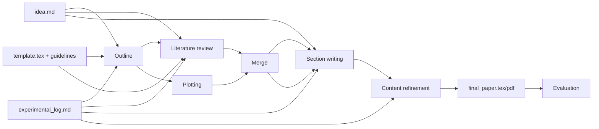

# Architecture

PaperOrchestra Skills is a skill-native implementation of the PaperOrchestra multi-agent pipeline. This document explains the data flow, why the stages are separated, and where failures are caught.

## Design in one paragraph

A paper is generated by five stages. Each stage reads a small set of files, writes one machine-readable artifact, and has a gate that can fail. The gates are the architecture: they prevent a fluent but unsupported output from silently becoming the input to the next stage. The orchestrator only sequences stages and checks gates; the specialist skills do the work.

## Data flow

Stages 2a (literature) and 2b (plotting) run concurrently because they share only immutable inputs and write to separate directories.

## Stage contracts

### 0. Inputs

Reads user files. Writes a normalized project layout. Gate: required files exist, the idea and log contain no leaked citations, identities, or result numbers, and figures referenced by `info.json` exist. Leakage is a blocking error by default.

### 1. Outline

Reads idea, log, template, guidelines, and cutoff. Writes `outline.json` with `plotting_plan`, `intro_related_work_plan`, and `section_plan`. Gate: valid JSON, three plans present, every named dependency has a citation hint.

### 2a. Literature

Reads the outline and source materials. Writes a verified registry, citation map, BibTeX, an updated outline with `citation_candidates`, and a template whose Introduction and Related Work are filled. Verification tries Semantic Scholar, arXiv, Crossref, and DBLP. Exploration matches use a title ratio above 70; targeted matches require >= 90 plus a year or author check. Gate: every citation verified, cutoff respected, keys consistent, per-cluster coverage present.

### 2b. Plotting

Reads the outline and source materials. Writes figures, `plotting_results.json`, and `figures/info.json`. Gate: every planned figure produced or explicitly skipped with a reason; every manifest entry resolves.

### 3. Section writing

Reads the merged template, outline, citation map, figures, idea, log, and guidelines. Writes `raw_draft_paper.tex`. Gate: the draft compiles.

### 4. Content refinement

Reads the draft, log, citation map, and guidelines. Writes review JSON, revised sources, screenshots, and the final `.tex`/`.pdf`. The reviewer is an independent context and produces three samples per round, aggregated by mean or median. Gate: compile succeeds, the aggregated reviewer score did not decrease, the page limit is met, no undefined citations or references.

### 5. Evaluation

Reads the final paper and optional ground truth. Writes metrics JSON. Gate: every metric is computed from real files and the judge configuration is recorded.

## Why these boundaries

**Outline before literature.** The search strategy depends on the story. Searching before deciding what the paper argues produces a survey, not a related-work section.

**Literature before writing.** The writer must see verified abstracts. If the writer discovers citations while drafting, it will hallucinate keys or misdescribe papers.

**Plotting parallel to literature.** Figures depend on the plan, not on the bibliography. Running them concurrently saves wall-clock time without coupling.

**Compile before review.** A reviewer looking at a broken PDF produces feedback about LaTeX errors, not about the science. The compile gate protects the review budget.

**Score-driven refinement.** Without an accept/reject rule, revision loops drift. The rule makes progress monotonic: keep a change only when the overall score rises, or when a tie hides no net sub-axis degradation.

## Artifacts as interfaces

Every artifact is inspectable JSON or LaTeX:

- `outline.json` is the contract between planning and execution.
- `registry.json` is the citation source of truth.
- `citation_map.json` is the writer's allowed bibliography.
- `figures/info.json` is the writer's figure manifest.
- `review_v*.json` records why a revision was kept or reverted.
- `*.compile.json` records the exact build commands and undefined references.

Because these are files, a run can be resumed, diffed, and audited. The `paper-orchestra` skill's `scripts/pipeline_status.py` reads them and reports the next runnable stage.

## Robustness choices

**Verification has fallbacks.** A single bibliographic API is a single point of failure. Semantic Scholar rate-limits unauthenticated traffic and can be blocked by a proxy. The resolver falls back to arXiv, Crossref, and DBLP, and rejects a match that cannot produce an abstract. Falling back to another source is allowed; falling back to model memory is not.

**Targeted matches are stricter.** A canonical paper lookup is a different task from exploring a field. A near-title match is often a different paper, so targeted verification requires a title ratio of at least 90 and a year or author check.

**Review is ensembled and independent.** The writer does not grade its own revision. Three reviewer samples at temperature 0.75 are aggregated, and the accept/reject rule operates on the aggregate. This reduces the chance that a single noisy sample flips the decision.

**The repository tests itself.** `tests/` covers the leakage gate, matching thresholds, provider normalization and fallback, bibliography construction, reviewer aggregation, LaTeX linting, template scaffolding, and the demo output. CI also compiles every bundled template.

## Failure handling

- A stage retries internally when its own skill says so.
- The orchestrator retries a whole stage at most twice.
- On the third failure, it stops and records the failing command, stderr tail, and artifact path.
- A missing artifact is never replaced with a hand-written approximation. A missing figure is better than a fabricated one.

## What is intentionally not here

The upstream repository is a Python application. This repository is a skill collection. Removed:

- Streamlit frontend and background process management.
- Gemini and OpenAI client wrappers, retry/backoff, and API key plumbing.
- PaperBanana image-generation calls. The plotting skill uses the host agent's tools and prefers code-generated plots and vector diagrams.
- Batch dataset processing, process pools, resume logs, and email delivery.
- The PaperWritingBench dataset (not included upstream).
- The full autorater orchestration code. The rubrics and the deterministic metrics remain.

The method and the prompts are preserved. Provider-specific execution is delegated to the host agent, which is the point of packaging this as skills.
